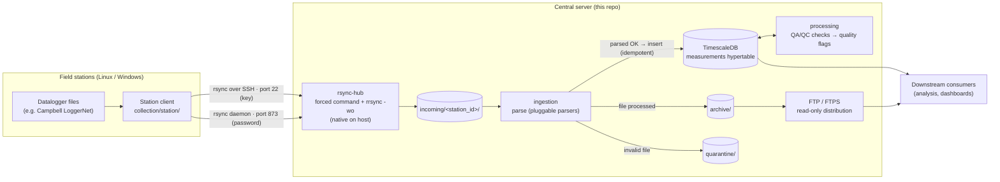

# carbonara-datahub

Central server (workstation) of the **CARBONARA** project — weather-station data for
forest monitoring in the Amazon. The datahub **concentrates and stores** the data
produced by the field stations: it receives the files pushed by the collection agents
(repo [`carbonara-stations`](https://github.com/CarbonARA-UFOPA/carbonara-stations) or
the simple clients shipped here) via **rsync-over-SSH**, parses them, loads them into a
time-series database, runs quality control over the fresh measurements, and distributes
the processed files downstream via read-only FTP.

## How it all works



Each station only ever *pushes*: its SSH key (or rsync-daemon account) is confined,
write-only, to its own `incoming/<station_id>/` directory. Everything to the right of
the landing directory is transport-agnostic — it does not know or care how a file
arrived. `rsync-hub monitor` shows connections and per-station liveness in real time.

## Components

Collection runs **natively on the host** (a single script, `rsync-hub`); the data stack
runs in **Docker Compose**:

| Component | What it is |
|-----------|------------|
| `rsync-hub` (host) | **One script** that does all of collection: authorizes/removes/lists stations, monitors connections (live mode) and acts as the SSH forced command that confines each station (write-only) to its `incoming/<station_id>/` folder. |
| `db` (compose) | PostgreSQL + **TimescaleDB** — stores the measurements (`measurements` as a hypertable, long/EAV model: new variables need no `ALTER TABLE`). |
| `ingestion` (compose) | Python service that watches `incoming/`, parses files (pluggable parsers) and loads them into the database; moves processed files to `archive/` and failures to `quarantine/`. Inserts are idempotent — reprocessing never duplicates. |
| `processing` (compose) | QA/QC service: periodically evaluates freshly ingested measurements with pluggable checks and marks `measurements.quality` flags. Never modifies raw values. |
| `ftp` (compose) | **Read-only distribution**: serves `archive/` to downstream consumers. It no longer receives data (collection migrated from FTP to rsync-over-SSH). |

## Collection (`collection/`): guided host (`rsync-hub`) + station clients

The **host** side (this workstation) is a guided script — `install` walks you through
root folder → service account → station authorization (after `install`, the script is
available as `rsync-hub` in `/usr/local/bin`):

```bash
sudo ./collection/rsync-hub install   # GUIDED host installation — once
sudo rsync-hub add flona01            # authorize by GENERATING the key here: stations/flona01/
                                      #   stores the key pair + activation INSTRUCOES.txt
sudo rsync-hub add flona01 f.pub      # or authorize an existing public key
sudo rsync-hub add flona01 --senha    # or by USER+PASSWORD (rsync daemon:873 — simpler
                                      #   on the client; data is NOT encrypted)
     rsync-hub list                   # list authorized stations
     rsync-hub monitor                # live view of connections and station status
     rsync-hub cliente                # step-by-step client setup instructions
     rsync-hub                        # interactive menu
```

The **client** side runs on the stations (Linux **or Windows**) — guided assistants in
[`collection/station/`](collection/station/): `carbonara-station.sh` (Linux) and
`carbonara-station.ps1` + `carbonara-station.cmd` (Windows). `setup` asks, in order:
station id → hub IP → auth mode (key or password) → connection test → data folder →
send interval (offering to install the schedule). The local data folder is **never
modified** — the client is a strict one-way synchronizer.
See [`collection/station/README.md`](collection/station/README.md).

Simple, real isolation: each station has a **key** that can only run `rsync-hub serve
<id>` (via `command="…",restrict` in `authorized_keys` — no shell/tunnel/PTY), and
`rrsync -wo` locks the transfer to that station's folder, **write-only** (it can upload,
but cannot download or reach the others). Ingestion moves each file to `archive/` right
after processing, taking it out of the station's reach.

## Quick start

```bash
cp .env.example .env                                     # set passwords and FTP_PUBLIC_HOST
cp ingestion/config.example.yaml ingestion/config.yaml   # CSV column → variable mapping
cp processing/config.example.yaml processing/config.yaml # valid physical ranges per variable
# generate the FTP TLS certificate (see ftp/README.md)
docker compose up -d
docker compose ps                                        # db, ingestion, processing, ftp
```

End-to-end test without a real station: drop a sample CSV into the landing directory
and watch it flow:

```bash
mkdir -p data/incoming/flona01
cp examples/sample-station-data/flona01_20260627.csv data/incoming/flona01/
docker compose logs -f ingestion
```

Full walkthrough in [`docs/installation.md`](docs/installation.md).

## Repository structure

```
carbonara-datahub/
├── docker-compose.yml        # db + ingestion + processing + ftp (distribution)
├── .env.example
├── collection/               # COLLECTION layer (rsync transport)
│   ├── rsync-hub             #   HOST side: guided install + management + monitor + forced command
│   └── station/              #   CLIENT side: guided assistants for Linux and Windows stations
├── ingestion/                # ingest.py + pluggable parsers + Dockerfile
├── processing/               # QA/QC: pluggable checks flag measurements.quality
├── database/init/            # idempotent SQL run on first start (schema + hypertable)
├── ftp/                      # FTP/FTPS config (distribution only) + operational docs in ftp/docs/
├── examples/                 # sample CSV for the end-to-end test
└── docs/                     # architecture, installation, maintenance
```

## Data model

Long/EAV time-series model — adding a new measured quantity is an `INSERT` into the
`variables` catalog, never an `ALTER TABLE`:

- `stations` — station metadata (location, forest type, fixed vs. mobile/roving);
- `variables` — catalog of quantities (`air_temp`, `co2`, …), seeded with common weather variables;
- `measurements` — fact hypertable, natural key `(time, station_id, variable_id)`,
  auto-compression after 30 days, hourly continuous aggregate (`measurements_hourly`).

`measurements.quality` convention: `0` ok/unevaluated · `1` parse-invalid (set by
ingestion) · `2` out of physical range (set by processing) · `3+` reserved for future
rules. Raw values are never altered — filter `quality = 0` for approved data.

## Decoupled layers

Transport, ingestion, processing and storage are **independent and swappable**,
connected only through the landing directory and the database:

```
collection/  → transport      (file arrives)
ingestion/   → parse + insert (file becomes raw rows)
processing/  → QA/QC          (rows get quality flags)
database/    → storage        (time series)
```

Ingestion depends **only** on the `incoming/` directory — it does not know how a file
arrived (the FTP → rsync migration swapped the transport layer without touching
ingestion, schema or database). A new file format is a new parser in
[`ingestion/parsers/`](ingestion/); a new quality rule is a new check in
[`processing/checks/`](processing/README.md). See
[`docs/architecture.md`](docs/architecture.md).

## Documentation

Internal documentation is written in Brazilian Portuguese:

- [Architecture](docs/architecture.md) — layers, data flow, design decisions;
- [Installation](docs/installation.md) — full walkthrough (collection + data stack);
- [Maintenance](docs/maintenance.md) — backup/restore, logs, troubleshooting.

Part of the [CarbonARA-UFOPA](https://github.com/CarbonARA-UFOPA) project. License: [MIT](LICENSE).
