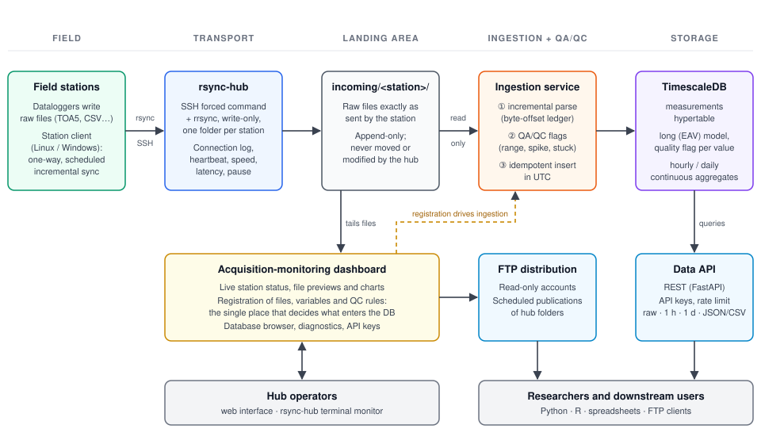

# CARBONARA DataHub

**A central data hub for automated environmental monitoring stations in the Amazon**

The CARBONARA DataHub is the central server of the CARBONARA project (Universidade Federal
do Oeste do Pará, UFOPA). The project runs meteorological and flux-measurement stations in
the Amazon forest. This repository holds the software that receives data from those
stations, checks and stores it, and makes it available to researchers. That work spans
four stages: transport from remote sites with unreliable links, conversion of
heterogeneous datalogger files into a consistent time series, quality control, and
distribution through a database, a web API and FTP.

---

## 1. Motivation

Research stations in the Amazon run mostly unattended. They are often connected through
4G or satellite links with high latency and frequent outages, and a technician may visit
a site only a few times a year. In these conditions the data pipeline must meet three
requirements:

1. **Data are never lost.** A failure anywhere in the chain may delay data, but must not
   delete or corrupt them. The original files written by the dataloggers are kept
   unchanged on both ends.
2. **The system runs with little intervention.** The stations send data on their own
   schedule, every stage of the pipeline can be repeated safely, and the server reports
   the state of each station clearly enough for an operator to tell a network outage
   from a sensor failure.
3. **Processing is traceable and reproducible.** Every value in the database can be
   traced back to the file and byte range it came from. Quality control marks values but
   never changes or removes them, and the whole database can be rebuilt from the raw
   files.

## 2. System overview

The system follows one main design rule: **transport, ingestion, quality control and
storage are separate layers that can be replaced independently.** Each layer only knows
the one before it through a shared directory or a database table. For example, the
system originally collected data over FTP and later moved to rsync-over-SSH; the
ingestion code, the schema and the database did not change.

<p align="center">
  
</p>

**Figure 1.** Architecture of the CARBONARA DataHub. Field stations send raw datalogger
files to the hub over rsync-over-SSH. Each station can only write to its own folder in
the landing area. The ingestion service reads these files incrementally, assigns a
quality flag to each value and inserts the values into a TimescaleDB database. The
monitoring dashboard is where operators decide which files and variables are ingested.
Researchers get data through the REST API or the read-only FTP server.

The data flow is as follows:

```
datalogger → station client → rsync/SSH → incoming/<station>/ → parse → QA/QC → TimescaleDB → API / FTP
```

## 3. Components

### 3.1 Field stations and the station client

At each station, a datalogger (typically Campbell Scientific hardware managed by
LoggerNet) writes measurements to text files. The most common format is TOA5; other
formats include CSV and space-separated profiler files. A small client script runs on the
station computer and sends these files to the hub. There is a Bash version for Linux,
scheduled with cron, and a PowerShell version for Windows, scheduled with Task Scheduler.
A guided setup wizard configures the client, so an operator without specialist training
can install a station.

The client is **strictly one-way**: it only reads the station's data folders and never
moves, renames or deletes anything in them. In each cycle it scans the configured
folders, compares each file's size and modification time with a local record of what has
already been sent, and transfers only new or changed files. It also sends a small
*heartbeat* file that states how often the station sends data, which lets the hub detect
when a station has gone offline. If a transfer fails, the client logs the failure and
classifies its cause (network, credentials, server paused, server disk full). The next
scheduled cycle simply retries, so the client never needs to be reconfigured on site
after a server-side problem.

### 3.2 Transport layer (`collection/rsync-hub`)

On the server, a single shell script, `rsync-hub`, handles all of data collection. It
registers stations, generates their SSH keys, monitors connections, and acts as the
gatekeeper for every incoming session. All stations log in through one locked service
account, and each station is isolated by three mechanisms:

- each station's SSH key may only run a fixed command bound to that station
  (`command="rsync-hub serve <id>",restrict`), with no shell, terminal or port forwarding;
- the transfer runs through `rrsync` in write-only mode and is confined to
  `incoming/<station>/`;
- the list of authorized keys is kept outside any directory that a station can write to.

For every session the hub logs the connection, the amount of data received, the useful
transfer rate and the round-trip time. The round-trip time is measured passively: the
hub reads it from the kernel's statistics for the TCP connection the station opened,
because most stations sit behind NAT and cannot be contacted directly. Operators can
pause data reception (for maintenance, a database migration or a full disk) without
revoking any credentials. While paused, stations keep their files and send them in full
once reception resumes. For sites where port 22 is blocked, an optional rsync-daemon mode
(port 873, password authentication) is also available.

### 3.3 Landing area (`incoming/`)

`incoming/<station>/` holds the raw files exactly as each station sent them. **Nothing in
this area is ever moved or modified by the hub.** Datalogger files grow over time as new
records are appended, so the hub treats them as continuous logs rather than as finished
files. Partial uploads are never visible: rsync writes to a hidden temporary file and
renames it only after the transfer is complete.

### 3.4 Ingestion (`ingestion/`, `carbonara_parse/`)

The ingestion service runs a polling loop that turns raw files into database rows. It does
not need to know how a file arrived. Which files it reads, and how, is set entirely by the
registrations made in the monitoring dashboard: for each file, the column separator, the
header lines, the timestamp column and format, the time zone, the list of variables, and
whether to average the data before storing it.

- **Incremental reading.** A ledger table records how far into each file the service has
  read (a byte offset) and a hash of the first part of the file. Each cycle reads only the
  new, complete lines. If a file gets shorter or its beginning changes, the service treats
  it as a replaced file and reads it again from the start.
- **Shared parser.** The parsing code is a package (`carbonara_parse`) shared by the
  ingestion service and the dashboard. The preview an operator checks in the dashboard
  therefore uses exactly the same code that later loads the database.
- **Time handling.** Each file declares the time zone of its timestamps, and every value
  is stored in UTC. High-frequency files (10–20 Hz) can be averaged into 1-minute or
  30-minute blocks before storage. Only complete averaging blocks are written.
- **Safe repetition.** Inserts ignore rows that already exist, using the key
  (time, station, variable). Running ingestion again over the same file therefore never
  creates duplicates. Since this re-ingestion can rebuild the database from the raw
  files, the database itself is not backed up.

### 3.5 Quality control (`processing/`)

Quality control is a library that the ingestion service runs between parsing and
inserting. Each value receives an integer quality flag before it is stored:

| Flag | Meaning |
|-----:|---------|
| `0` | value passed all checks |
| `1` | could not be parsed (invalid number or timestamp) |
| `2` | outside the physical range set for the variable (`min`/`max`) |
| `3` | spike: jump from the previous reading larger than the allowed limit |
| `4` | stuck sensor: the same value repeated N times in a row |

The checks only **mark** values; no value is changed or removed, so the raw data remain
auditable. Thresholds can be set for each variable in the dashboard, and settings in a
global configuration file apply where no per-variable value is given. New checks can be
added as plug-in modules without changing the ingestion code.

### 3.6 Storage (TimescaleDB)

Measurements are stored in PostgreSQL with the TimescaleDB extension (PostGIS is used for
station locations). The schema uses a long format, with one row per (time, station,
variable). Adding a new measured quantity therefore only requires a new entry in the
variable catalog, never a change to the table structure. The main table, `measurements`,
is a hypertable: TimescaleDB splits it into time chunks and compresses chunks older than
30 days. Hourly and daily averages are maintained automatically as continuous aggregates,
which include only values with flag `0`. For easier browsing, the system also creates a
schema for each station and data type, containing one *view* per monitored file, with one
column per variable. All of these views read from the same `measurements` table, so the
data are stored only once.

### 3.7 Access: Data API and FTP (`api/`, `ftp/`)

- **Data API** (FastAPI): exposes stations, variables and time series as raw data or
  hourly/daily averages, in JSON or CSV. Users can choose a time zone and whether to
  include flagged values. Access is controlled by API keys with different permission
  levels, expiry dates and per-key rate limits; the server stores only a hash of each key.
- **FTP distribution** (vsftpd): provides read-only accounts. Folders on the hub are
  published to the FTP area on a schedule, either by copying or through read-only bind
  mounts.

### 3.8 Acquisition-monitoring dashboard (`dashboard/`)

A web application (Flask and Chart.js, running directly on the host) is the operators'
main tool. It shows the live status of each station (*receiving*, *online*, *offline* or
*paused*), using the same rules as the `rsync-hub` terminal monitor. It also shows how
recent the newest record in each file is, which reveals a failed sensor even when the
station's link is working. Other functions include file previews and per-variable charts
with physical-limit lines, station management, and the **registration of files and
variables to be ingested**. This registration is the only way to decide what enters the
database, and the screen where QC thresholds are set. The dashboard also includes a
database browser, maintenance and diagnostic tools, API key management and FTP
administration. The interface is available in Portuguese and English.

## 4. Design principles

| Principle | How it is implemented |
|-----------|-----------------------|
| Raw data are preserved | Station folders and `incoming/` are only ever read; QC marks values but never changes them |
| A failure delays data but never loses it | Clients keep their send status until a transfer succeeds; pausing reception postpones transfers; control files are written atomically (write a temporary file, then rename it) |
| Every stage can be safely repeated | Inserts skip existing keys, files are read by byte offset, and stored data can be reset and re-read per file |
| Traceability | Every row records the file it came from; administrative actions are logged |
| Layers are independent | Layers are connected only through the landing directory and the database |
| Low resource use | Files are read in fixed-size pieces, never loaded whole; the monitor reads each log once per refresh |
| Least privilege for stations | Write-only access confined to one folder, no shell, and all keys pinned to fixed commands |

## 5. Deployment

The production server is a single host (4 vCPU, 7.6 GB RAM) with an 8 TB data disk. The
database, ingestion service and API run in Docker Compose. The collection script, the
dashboard and the FTP server run directly on the host.

```bash
sudo ./database/setup-db-host.sh          # host preparation: Docker on the data disk, .env
sudo ./collection/rsync-hub install       # guided setup of the collection layer
docker compose up -d --build              # database + ingestion + API
./database/migrate.sh                     # apply schema migrations
cd dashboard && ./dashboardctl servico    # monitoring dashboard as a systemd service
```

Detailed procedures, including station activation, are documented in Portuguese in
[`docs/installation.md`](docs/installation.md), [`docs/architecture.md`](docs/architecture.md),
[`docs/maintenance.md`](docs/maintenance.md) and [`docs/estrategia-dados.md`](docs/estrategia-dados.md).

## 6. Repository structure

```
carbonara-datahub/
├── collection/        transport layer: rsync-hub (server) and station clients (Linux/Windows)
├── ingestion/         incremental ingestion service
├── carbonara_parse/   file parser shared by ingestion and dashboard
├── processing/        QA/QC library (range, spike, persistence checks)
├── database/          initial schema, migrations and host setup
├── api/               REST data API (FastAPI)
├── dashboard/         acquisition-monitoring dashboard (Flask)
├── ftp/               FTP account manager and distribution
├── examples/          sample station data
└── docs/              architecture, installation, maintenance, data strategy, figures
```

## 7. Technologies

Bash, rsync, OpenSSH (`rrsync`) · Python 3 · PostgreSQL 16 + TimescaleDB 2 + PostGIS ·
FastAPI + asyncpg · Flask + Chart.js · vsftpd · Docker Compose · PowerShell 5.1 + cwRsync
(Windows stations).

## 8. Credits and license

Developed by Helvecio Neto for the [CarbonARA-UFOPA](https://github.com/CarbonARA-UFOPA)
project, Universidade Federal do Oeste do Pará (UFOPA).
Released under the [MIT License](LICENSE).
