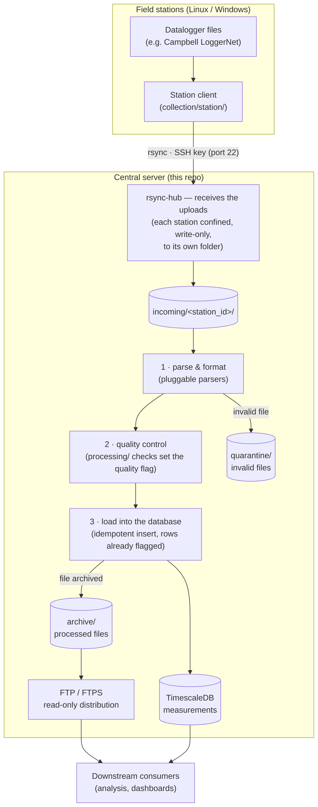

# carbonara-datahub

Central server (workstation) of the **CARBONARA** project — weather-station data for
forest monitoring in the Amazon. The datahub **concentrates and stores** the data
produced by the field stations: it receives the files pushed by the collection agents
(repo [`carbonara-stations`](https://github.com/CarbonARA-UFOPA/carbonara-stations) or
the simple clients shipped here) via **rsync-over-SSH**, parses them, loads them into a
time-series database, runs quality control over the fresh measurements, and distributes
the processed files downstream via read-only FTP.

## How it all works



Each station only ever *pushes*: its SSH key (or rsync-daemon account) is confined,
write-only, to its own `incoming/<station_id>/` directory. Everything below the landing
directory is transport-agnostic — it does not know or care how a file arrived. Steps
1–3 run inside the `ingestion` service: parsers format the raw files, the QC checks
from `processing/` qualify every measurement **before** it reaches the database, and
rows are inserted already carrying their quality flag. `rsync-hub monitor` shows
connections and per-station liveness in real time.

## Components

Collection runs **natively on the host** (a single script, `rsync-hub`); the data stack
runs in **Docker Compose**:

| Component | What it is |
|-----------|------------|
| `rsync-hub` (host) | **One script** that does all of collection: authorizes/removes/lists stations, monitors connections (live mode) and acts as the SSH forced command that confines each station (write-only) to its `incoming/<station_id>/` folder. |
| `db` (compose) | PostgreSQL + **TimescaleDB** — stores the measurements (`measurements` as a hypertable, long/EAV model: new variables need no `ALTER TABLE`). |
| `ingestion` (compose) | Python service that watches `incoming/`, parses files (pluggable parsers), runs the QC pipeline and loads the flagged measurements into the database; moves processed files to `archive/` and failures to `quarantine/`. Inserts are idempotent — reprocessing never duplicates. |
| `processing/` (library) | QA/QC pipeline applied **in memory, between parse and insert**: pluggable checks compute the `quality` flag each measurement carries into the database. Raw values are never modified or dropped. Runs inside the ingestion container. |
| `ftp` (compose) | **Read-only distribution**: serves `archive/` to downstream consumers. It no longer receives data (collection migrated from FTP to rsync-over-SSH). |
| `dashboard/` (native) | **Data-acquisition monitoring dashboard** (Flask + Chart.js, no Docker; by Helvecio Neto): register stations, watch `.dat` files (tail + per-variable charts with physical limits) and show live station status from the rsync-hub heartbeat. Viewing is open; editing requires the admin login. The full dashboard (reading the DB) comes later. |

## Collection (`collection/`): guided host (`rsync-hub`) + station clients

The **host** side (this workstation) is a guided script — `install` walks you through
root folder → service account → station authorization (after `install`, the script is
available as `rsync-hub` in `/usr/local/bin`):

```bash
sudo ./collection/rsync-hub install   # GUIDED host installation — once
sudo rsync-hub add flona01            # authorize by GENERATING the key here: stations/flona01/
                                      #   stores the key pair + activation INSTRUCOES.txt
sudo rsync-hub add flona01 f.pub      # or authorize an existing public key
sudo rsync-hub pause --todas "maintenance"   # PAUSE reception (all stations)
sudo rsync-hub pause flona01          # pause a single station
sudo rsync-hub resume --todas         # resume reception
     rsync-hub diagnostico            # why can't the stations send? (disk, keys, home, pause)
sudo rsync-hub diagnostico --reparar  # re-authorize stations from the .pub kept on the hub
     rsync-hub list                   # list authorized stations
     rsync-hub monitor                # live view of connections and station status
     rsync-hub cliente                # step-by-step client setup instructions
     rsync-hub                        # interactive menu
```

The **client** side runs on the stations (Linux **or Windows**) — guided assistants in
[`collection/station/`](collection/station/): `carbonara-station.sh` (Linux) and
`carbonara-station.ps1` + `carbonara-station.cmd` (Windows). `setup` asks, in order:
station id → hub IP → auth mode (SSH key) → connection test → data folder →
send interval (offering to install the schedule). The local data folder is **never
modified** — the client is a strict one-way synchronizer.
See [`collection/station/README.md`](collection/station/README.md).

Simple, real isolation: each station has a **key** that can only run `rsync-hub serve
<id>` (via `command="…",restrict` in `authorized_keys` — no shell/tunnel/PTY), and
`rrsync -wo` locks the transfer to that station's folder, **write-only** (it can upload,
but cannot download or reach the others). Ingestion moves each file to `archive/` right
after processing, taking it out of the station's reach.

## Adding a new station — step by step

Three moves: **authorize it on the hub** → **carry the key + the client to the station**
→ **run the guided setup there**. The screens below are the real output of the scripts
(in Brazilian Portuguese, like everything user-facing) for a station called `flona01`.

### 1 · On the hub: authorize the station

Run it as root; without a public-key file, the key pair is **generated here**:

```console
$ sudo rsync-hub add flona01
script instalado/atualizado em /usr/local/bin/rsync-hub (a chave aponta para lá).
estação 'flona01' autorizada (pasta /srv/carbonara/incoming/flona01).
chave da estação gerada e guardada em /srv/carbonara/stations/flona01/:
    flona01_key        ← COPIE para a máquina da estação (chave privada)
    flona01_key.pub    ← permanece aqui (já autorizada)
    INSTRUCOES.txt   ← passo a passo de ativação, para acompanhar a chave
(arquivos legíveis pelos usuários locais do host — a cópia dispensa sudo.)
```

```console
$ ls /srv/carbonara/stations/flona01/
INSTRUCOES.txt  flona01_key  flona01_key.pub
```

`INSTRUCOES.txt` is the activation sheet for that station (server address, port, service
account and the wizard order) — carry it along with the key.

### 2 · Carry the key and the client to the station

| Station OS | Files to copy (same folder on the station) |
|------------|--------------------------------------------|
| **Linux**   | `flona01_key` · `collection/station/carbonara-station.sh` |
| **Windows** | `flona01_key` · `collection/station/carbonara-station.ps1` · `carbonara-station.cmd` |

The easiest way is to **pull everything from the hub, from the station itself** — those
files are world-readable on the hub, so any regular login works and no `sudo` is needed
(`usuario` below = your normal account on the hub; `200.139.13.53` = the hub's address).

**From a Linux station:**

```bash
# 1. the station folder (private key + INSTRUCOES.txt)
scp -r usuario@200.139.13.53:/srv/carbonara/stations/flona01 ~/

# 2. the client script (repo checkout on the hub)
scp usuario@200.139.13.53:~/carbonara-datahub/collection/station/carbonara-station.sh ~/
chmod +x ~/carbonara-station.sh
```

**From a Windows station** (PowerShell — `scp` ships with Windows 10/11):

```powershell
mkdir C:\carbonara ; cd C:\carbonara
scp usuario@200.139.13.53:/srv/carbonara/stations/flona01/flona01_key .
scp usuario@200.139.13.53:~/carbonara-datahub/collection/station/carbonara-station.ps1 .
scp usuario@200.139.13.53:~/carbonara-datahub/collection/station/carbonara-station.cmd .
```

No network to the hub? A USB stick with the same files does the job.

> **Windows:** keep everything in a path **without spaces** (e.g. `C:\carbonara\`) — rsync
> chokes on spaces in the key path. Copy **both** `.ps1` and `.cmd`: the `.cmd` is what you
> run (Windows blocks `.ps1` files by default).

### 3a · On a Linux station: run the wizard

```console
$ chmod +x carbonara-station.sh
$ ./carbonara-station.sh setup

===== Configuração guiada da estação (Linux) =====
Você vai precisar de: o ENDEREÇO (IP) do servidor central, o ID desta estação
e o arquivo de CHAVE recebido do servidor (gerado lá por 'rsync-hub add <id>',
que também cria um INSTRUCOES.txt com esses dados).

Id desta estação (minúsculas/dígitos/_ , ex.: flona01): flona01
IP (ou hostname) do servidor central [200.139.13.53]:
Como esta estação se autentica no servidor?
  1) chave SSH (recomendado — tráfego criptografado; porta 22)
  …
modo [1]:
Porta SSH do servidor [22]:
Conta de serviço no servidor — NÃO é o id da estação; aperte Enter [carbonara]:
Caminho local da CHAVE desta estação (arquivo flona01_key recebido do servidor): /home/operador/flona01_key

Testar a conexão com o servidor agora? [S/n]:
ok: o servidor respondeu e aceitou a credencial.

Pasta LOCAL principal a enviar por rsync [/home/operador/carbonara-dados]: /var/dados/loggernet
Filtros desta pasta (opcionais — Enter deixa em branco):
  Tipos de arquivo a NÃO enviar (globs por vírgula, ex.: *.tmp,*.bak): *.tmp
  Subpastas a NÃO enviar (por vírgula, ex.: temp,cache):
  (dá para adicionar mais pastas depois: menu → 'Gerenciar pastas' ou 'carbonara-station.sh folders'.)
Idade mínima (minutos) para um arquivo ser considerado pronto [1]:
  (as pastas locais NUNCA são alteradas: nada é movido nem apagado — o envio só
   sincroniza com o servidor o que for novo ou mudar.)
Tempo de reciclagem do envio — a cada quantos minutos? (1-59) [10]: 15

ok: configuração gravada em /home/operador/.config/carbonara-station/config (pastas em /home/operador/.config/carbonara-station/folders).

Ativar o envio automático agora (a cada 15 min, via cron)? [S/n]:
ok: envio automático ativo a cada 15 min (cron do usuário operador).
para remover: carbonara-station.sh unschedule
```

Send once by hand to confirm:

```console
$ ./carbonara-station.sh send
sincronizando 42 arquivo(s) novo(s)/alterado(s) com 200.139.13.53…
  [loggernet] 42 arquivo(s) de /var/dados/loggernet…
ok: 42 arquivo(s) sincronizados (nada foi movido ou apagado localmente).
```

### 3b · On a Windows station: run the wizard

The **first** run installs rsync (cwRsync) and needs an elevated PowerShell — only that
once:

```console
C:\carbonara> .\carbonara-station.cmd setup

===== Configuração guiada da estação (Windows) =====

*** PRIMEIRA CONFIGURAÇÃO: é preciso instalar o rsync (cwRsync). ***

Para isso, abra o PowerShell COMO ADMINISTRADOR:
    menu Iniciar → digite "PowerShell" → clique com o botão DIREITO
    → "Executar como administrador"

e, na janela que abrir, rode o setup de novo:
    cd "C:\carbonara"
    .\carbonara-station.cmd setup

(só esta primeira vez precisa de administrador; o uso normal, não.)
```

Reopen as Administrator and run it again — from here on it is the same wizard as Linux:

```console
C:\carbonara> .\carbonara-station.cmd setup

===== Configuração guiada da estação (Windows) =====

O cwRsync será baixado e instalado em C:\cwrsync (uma vez só).
Baixar e instalar agora? [S/n]:
baixando de https://itefix.net/... (aprox. 5 MB)…
extraindo para C:\cwrsync…
ok: rsync instalado (C:\cwrsync\bin\rsync.exe).

rsync: C:\cwrsync\bin\rsync.exe

Id desta estação (minúsculas/dígitos/_ , ex.: flona01): flona01
IP (ou hostname) do servidor central [200.139.13.53]:
Como esta estação se autentica no servidor?
  1) chave SSH (recomendado — tráfego criptografado; porta 22)
  …
modo [1]:
Porta SSH do servidor [22]:
Conta de serviço no servidor — NÃO é o id da estação; aperte Enter [carbonara]:
Caminho local da CHAVE desta estação (arquivo flona01_key recebido do servidor): C:\carbonara\flona01_key

Testar a conexão com o servidor agora? [S/n]:
ok: o servidor respondeu e aceitou a credencial.

Pasta LOCAL principal a enviar por rsync [C:\Campbellsci\LoggerNet]:
Filtros desta pasta (opcionais — Enter deixa em branco):
  Tipos de arquivo a NÃO enviar (globs por vírgula, ex.: *.tmp,*.bak):
  Subpastas a NÃO enviar (por vírgula, ex.: temp,cache):
Idade mínima (minutos) para um arquivo ser considerado pronto [1]:
Tempo de reciclagem do envio — a cada quantos minutos? (1-1439) [10]: 15

ok: configuração gravada em C:\Users\operador\AppData\Local\carbonara-station\config.json.

Para o envio continuar com a janela FECHADA, sem login e APÓS REINICIAR, a
tarefa precisa rodar como SYSTEM — isso pede administrador (aparece o aviso UAC).
ok: envio automático ativo a cada 15 min como SYSTEM (tarefa 'CarbonaraStationSend').
roda com a janela fechada, sem ninguém logado e após reiniciar.
```

Running `carbonara-station.cmd` with no arguments opens an interactive menu (`test`,
`send`, `folders`, `status`, `schedule`…).

### 4 · Back on the hub: confirm the data is arriving

```console
$ rsync-hub monitor
rsync-hub v2026-07-23.2 — monitor (atualiza a cada 3s · Ctrl-C sai)   2026-08-05 14:32:07

  ESTAÇÃO          STATUS             ÚLTIMO SINAL (local)   CICLO    PASTA
● flona01          Online             2026-08-05 14:31:12    15 min   /srv/carbonara/incoming/flona01
● flona02          Offline            2026-08-04 09:10:44    10 min   /srv/carbonara/incoming/flona02

últimas conexões (chave SSH, hora local):
  2026-08-05 14:31:05 CONNECT flona01 200.139.13.90
  2026-08-05 14:31:12 DISCONNECT flona01 200.139.13.90
```

Green ● = a live signal within the station's window · purple ● = receiving right now ·
red ● = offline. Then watch the files become measurements:
`docker compose logs -f ingestion`.

### If something fails

| Symptom (on the station) | Cause / fix |
|--------------------------|-------------|
| `Permission denied (publickey)` | wrong service account (it is `carbonara`, **not** the station id), or the key is not the one generated for this id |
| `rsync-hub: Permission denied` | problem **on the hub** — re-run `sudo rsync-hub add <id>` there (it rewrites the key pointing at `/usr/local/bin/rsync-hub`) |
| `Connection timed out` | wrong IP or port 22 blocked, or no route to the hub |
| Station stays **Offline** in the monitor | the schedule is not running: `./carbonara-station.sh status` (Linux) or `schtasks /Query /TN CarbonaraStationSend` (Windows) |

Revoke a station at any time with `sudo rsync-hub remove flona01`.

## Quick start

```bash
cp .env.example .env                                     # set passwords and FTP_PUBLIC_HOST
cp ingestion/config.example.yaml ingestion/config.yaml   # CSV column → variable mapping
cp processing/config.example.yaml processing/config.yaml # valid physical ranges per variable
# generate the FTP TLS certificate (see ftp/README.md)
docker compose up -d
docker compose ps                                        # db, ingestion, ftp
```

End-to-end test without a real station: drop a sample CSV into the landing directory
and watch it flow:

```bash
mkdir -p data/incoming/flona01
cp examples/sample-station-data/flona01_20260627.csv data/incoming/flona01/
docker compose logs -f ingestion
```

Full walkthrough in [`docs/installation.md`](docs/installation.md).

### Acquisition-monitoring dashboard (optional, runs natively)

```bash
cd dashboard
cp config.example.yaml config.yaml     # set data_root (/srv/carbonara in production)
pip install -r requirements.txt
python run.py                          # http://localhost:8080
```

Register stations, point each one at its `.dat` files (tail lines, column separator,
variable mapping — with a parse preview) and at the rsync-hub heartbeat for live
online/offline status. Details in [`dashboard/README.md`](dashboard/README.md).

## Repository structure

```
carbonara-datahub/
├── docker-compose.yml        # db + ingestion (QC embedded) + ftp (distribution)
├── .env.example
├── collection/               # COLLECTION layer (rsync transport)
│   ├── rsync-hub             #   HOST side: guided install + management + monitor + forced command
│   └── station/              #   CLIENT side: guided assistants for Linux and Windows stations
├── ingestion/                # ingest.py + pluggable parsers + Dockerfile
├── processing/               # QA/QC library: pluggable checks flag quality before insert
├── dashboard/                # acquisition-monitoring dashboard (Flask + Chart.js, runs natively)
├── database/init/            # idempotent SQL run on first start (schema + hypertable)
├── ftp/                      # FTP/FTPS config (distribution only) + operational docs in ftp/docs/
├── examples/                 # sample CSV for the end-to-end test
└── docs/                     # architecture, installation, maintenance
```

## Data model

Long/EAV time-series model — adding a new measured quantity is an `INSERT` into the
`variables` catalog, never an `ALTER TABLE`:

- `stations` — station metadata (location, forest type, fixed vs. mobile/roving);
- `variables` — catalog of quantities (`air_temp`, `co2`, …), seeded with common weather variables;
- `measurements` — fact hypertable, natural key `(time, station_id, variable_id)`,
  auto-compression after 30 days, hourly continuous aggregate (`measurements_hourly`).

`measurements.quality` convention: `0` ok · `1` parse-invalid (set by the parser) ·
`2` out of physical range (set by the QC pipeline) · `3+` reserved for future rules.
Every row enters the database already flagged; raw values are never altered or
dropped — filter `quality = 0` for approved data.

## Decoupled layers

Transport, ingestion, processing and storage are **independent and swappable**,
connected only through the landing directory and the database:

```
collection/  → transport      (file arrives)
ingestion/   → parse          (file becomes measurements)
processing/  → QA/QC          (each measurement gets its quality flag, in memory)
database/    → storage        (rows land already qualified)
```

Ingestion depends **only** on the `incoming/` directory — it does not know how a file
arrived (the FTP → rsync migration swapped the transport layer without touching
ingestion, schema or database). A new file format is a new parser in
[`ingestion/parsers/`](ingestion/); a new quality rule is a new check in
[`processing/checks/`](processing/README.md). See
[`docs/architecture.md`](docs/architecture.md).

## Documentation

Internal documentation is written in Brazilian Portuguese:

- [Architecture](docs/architecture.md) — layers, data flow, design decisions;
- [Installation](docs/installation.md) — full walkthrough (collection + data stack);
- [Maintenance](docs/maintenance.md) — backup/restore, logs, troubleshooting.

Part of the [CarbonARA-UFOPA](https://github.com/CarbonARA-UFOPA) project. License: [MIT](LICENSE).
